# KivaFlow

Rutas de *picking* y cuellos de botella en un almacén inteligente tipo Amazon, modelado como un grafo de **1800 nodos y 3515 aristas**.

Proyecto del curso **Complejidad Algorítmica (1ACC0184)**, Universidad Peruana de Ciencias Aplicadas, 2026-2.

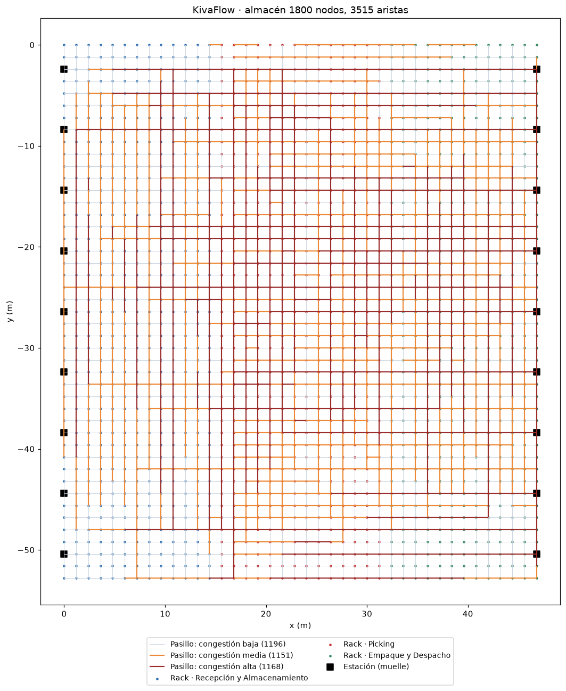

## Estado

| Parte | Estado |
|---|---|
| Dataset (layout + tráfico simulado) | ✅ reproducible, con tests |
| Pedidos reales de Instacart | 🧪 script listo; falta correrlo con los datos de Kaggle |
| MST: Kruskal (con UFDS) y Prim | ✅ a mano, comparados con NetworkX · demo: `python scripts/demo_mst.py` |
| BFS, Bellman-Ford, Ford-Fulkerson y Edmonds-Karp, Floyd-Warshall, MST por fuerza bruta, mochila 0/1 | ✅ a mano, con tests · demo: `python scripts/demo.py todo` |
| Orden de visita óptimo de un pedido (programación dinámica de Held-Karp) frente al voraz | ✅ a mano, comparado con la fuerza bruta en los tests |
| Aplicativo en matplotlib: pedido con clics, tiempo, memoria y operaciones | ✅ `python scripts/app.py` |
| Análisis de escalabilidad y experimento con 160 pedidos | ✅ `python scripts/analisis.py` · `python scripts/experimento.py` |
| GUI web con enlace público | 🔜 hito 3 |

## Ramas

| Rama | Qué tiene |
|---|---|
| `hito2` | Avance paso a paso desde el TB1: dataset, MST (Kruskal y Prim) BFS, Bellman-Ford, Edmonds-Karp y los demás algoritmos de la unidad 2, con demo en matplotlib. Va con el informe del hito 2 |
| `tb2` | Todo lo avanzado para el trabajo final: BFS, Bellman-Ford, Edmonds-Karp, simulación y la app web |
| `main` | Igual que `tb2` por ahora; de aquí sale la app publicada |

## Cómo ejecutar el avance del hito 2

```bash
git clone https://github.com/YhoshuaCZ/kivaflow.git && cd kivaflow
git switch hito2
python -m venv .venv
.venv/Scripts/activate          # Windows; en Linux/Mac: source .venv/bin/activate
pip install -r requirements.txt

python scripts/app.py           # el aplicativo (ventana)
python scripts/carrera.py rutas --origen 20-20   # dos algoritmos trabajando en el tiempo (también: mst, flujo)
python scripts/analisis.py      # cómo crecen tiempo y memoria con el tamaño del almacén (abre la gráfica)
python scripts/experimento.py   # 160 pedidos: cuánto ahorra Bellman-Ford y cuánto el orden óptimo (unos 4 min)
python -m pytest                # 80 pruebas
```

### Qué hace falta para ejecutarlo en otra computadora

Python 3.10 o más reciente y las librerías de `requirements.txt` (`matplotlib` para las ventanas y figuras; `networkx` y `pytest` solo para las pruebas). No hay nada que configurar: cada script encuentra solo la carpeta del proyecto.

| Carpeta | Qué tiene | ¿Hace falta para ejecutar? |
|---|---|---|
| `kivaflow/` | Los algoritmos, programados a mano, y la lectura del dataset | Sí |
| `scripts/` | Los programas que se ejecutan: `app.py`, `carrera.py`, `demo.py`, `analisis.py`, `experimento.py` | Sí |
| `data/` | El dataset: `nodos.csv` y `aristas.csv` (y `skus.csv`, que solo usan las pruebas) | Sí; se regenera idéntico con `python scripts/generar_dataset.py` |
| `resultados/` | Figuras y tablas que generan los scripts | No; se crea sola. Está en el repo porque este README muestra sus imágenes |
| `tests/` | Las pruebas (`python -m pytest`) | No |
| `docs/image/` | Imágenes de este README | No |

### El aplicativo (`scripts/app.py`)

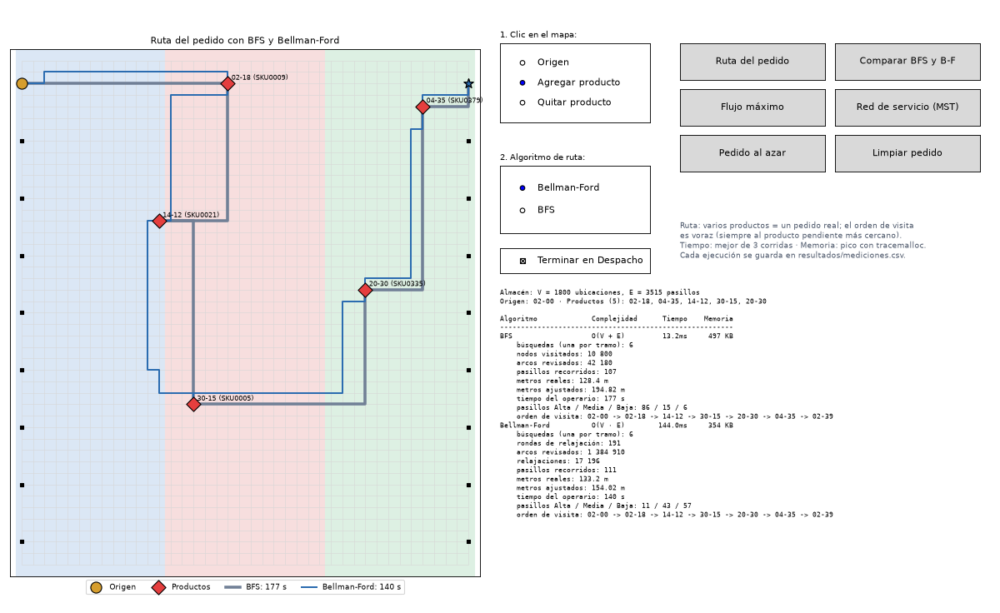

1. **Arma un pedido con clics en el mapa.** Elige el modo «Origen» (de dónde sale el operario) o «Agregar producto» y haz clic en una ubicación. «Pedido al azar» elige productos según su popularidad. Un pedido tiene varios productos porque así son los pedidos reales: el operario sale una vez y recoge todo. El orden de visita por defecto es **voraz** (siempre va al producto pendiente más cercano), porque el orden óptimo es el problema del viajante, que es NP-difícil.
2. **«Ruta del pedido»** calcula el recorrido con el algoritmo elegido. **«Comparar BFS y B-F»** dibuja los dos sobre el mismo pedido. Con «Terminar en Despacho», el recorrido acaba en el muelle de Despacho más cercano.
3. **«Orden: voraz vs óptimo»** recorre el mismo pedido con los dos órdenes de visita (ver abajo). **«Ver congestión»** pinta cada pasillo según su nivel, para ver qué esquiva Bellman-Ford.
4. **«Flujo máximo»** (Edmonds-Karp y Ford-Fulkerson con DFS) y **«Red de servicio (MST)»** (Kruskal y Prim) analizan el almacén completo.
5. Los botones amarillos **«Carrera…»** abren la carrera en el tiempo (ver abajo) desde el origen elegido.

Cada ejecución muestra, por algoritmo:

| Medida | Qué es | Cómo se mide |
|---|---|---|
| **Tiempo** (velocidad) | Cuánto tarda | `time.perf_counter`, el mejor de 3 corridas |
| **Memoria** (espacio) | Pico de memoria que reservó mientras corría | `tracemalloc`, en una corrida aparte para no ensuciar el tiempo |
| **Operaciones** | Nodos visitados, arcos revisados, relajaciones, caminos de aumento… | Contadores dentro de cada algoritmo; no dependen de la computadora |
| **Complejidad teórica** | La O grande | Se compara con lo medido en `analisis.py` |
| **Calidad del resultado** | Pasillos, metros, segundos del operario, pasillos congestionados, flujo, costo del árbol | Sobre el recorrido o el resultado |

Todo se agrega a `resultados/mediciones.csv` (no se sube al repo). Sin ventana: `python scripts/app.py --consola --origen 02-00 --productos 40-14,10-20,30-30`.

### Orden de visita óptimo (`kivaflow/orden.py`)

La regla voraz es rápida, pero no siempre acierta: a veces conviene pasar primero por un producto más lejano para no tener que volver. Probar todos los órdenes cuesta n! (con 10 productos, 3 628 800). **Held-Karp** lo resuelve exacto con programación dinámica sobre subconjuntos:

```
dp[S][j] = menor costo de salir del origen, visitar los productos de S y terminar en j
dp[S][j] = min sobre i en S − {j} de  dp[S − {j}][i] + d(i, j)
```

Son n · 2ⁿ⁻¹ estados y O(n² · 2ⁿ) en total: con 10 productos, 5120 estados. Sigue siendo exponencial, así que se limita a 12 productos. Las distancias d(i, j) salen de las mismas n + 1 búsquedas de Bellman-Ford que ya hace el voraz, por eso el orden óptimo casi no cuesta tiempo extra. Los tests lo comparan con la fuerza bruta (todas las permutaciones).

### Experimento con 160 pedidos (`scripts/experimento.py`)

El aplicativo compara un pedido a la vez; el experimento repite la comparación con 40 pedidos al azar de cada tamaño (misma semilla, mismos pedidos). Tiempo medio de caminata del operario:

| Productos | BFS + voraz | Bellman-Ford + voraz | Bellman-Ford + óptimo | Ahorro por esquivar la congestión | Ahorro extra por ordenar mejor | Pedidos donde el voraz ya era óptimo |
|---|---|---|---|---|---|---|
| 2 | 128,6 s | 101,5 s | 99,3 s | 21,1 % | 2,1 % | 80 % |
| 4 | 167,8 s | 135,7 s | 127,9 s | 19,1 % | 5,7 % | 40 % |
| 6 | 208,5 s | 169,2 s | 155,8 s | 18,8 % | 8,0 % | 28 % |
| 8 | 227,8 s | 187,1 s | 169,5 s | 17,9 % | 9,4 % | 20 % |

- **Esquivar la congestión** (Bellman-Ford en vez de BFS) ahorra cerca de 19 % de caminata en todos los tamaños, a cambio de unas 10 veces más tiempo de cálculo.
- **Ordenar mejor** importa más cuanto más grande es el pedido: con 2 productos el voraz casi siempre acierta; con 8 solo acierta en 1 de cada 5 pedidos y el óptimo ahorra 9,4 % adicional.

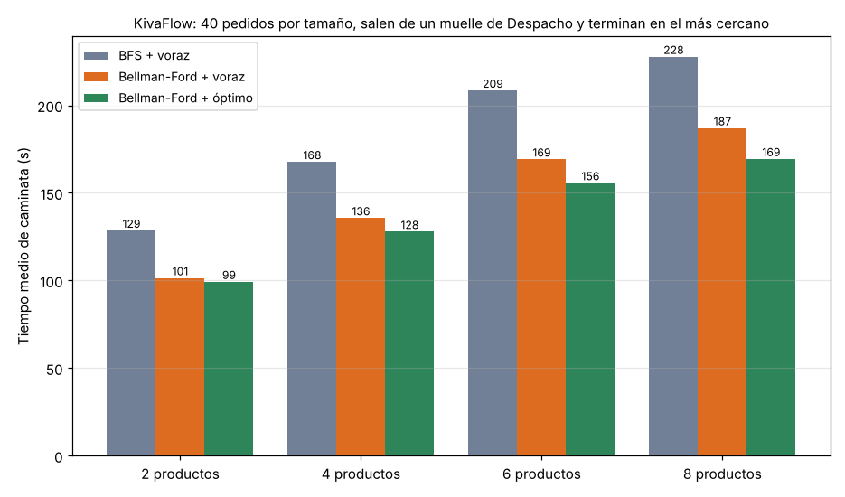

### Carrera en el tiempo (`scripts/carrera.py`)

Dos algoritmos resuelven lo mismo y se ve, con **un reloj común**, qué hizo cada uno en cada instante. No es paso a paso: cada algoritmo corre de verdad y anota el instante exacto de cada avance; después se reproduce en cámara lenta (los milisegundos reales duran unos segundos en pantalla). Abajo, la curva muestra qué porcentaje de su trabajo llevaba cada uno en cada momento.

| Carrera | Qué se ve |
|---|---|
| `rutas` (BFS vs. Bellman-Ford) | BFS descubre cada ubicación una sola vez, en ondas. Bellman-Ford mejora distancias ronda tras ronda; en naranja, las que tuvo que volver a mejorar. Desde una esquina (02-00) los dos terminan rápido; desde el centro (20-20), Bellman-Ford tarda varias veces más |
| `mst` (Kruskal vs. Prim) | Kruskal arma pedazos sueltos en todo el almacén y los va uniendo (UFDS); Prim hace crecer un solo árbol desde un punto |
| `flujo` (Edmonds-Karp vs. Ford-Fulkerson con DFS) | Cada trazo es un camino de aumento. Edmonds-Karp usa los más cortos (rectos); DFS se mete por caminos largos y tortuosos y necesita más |

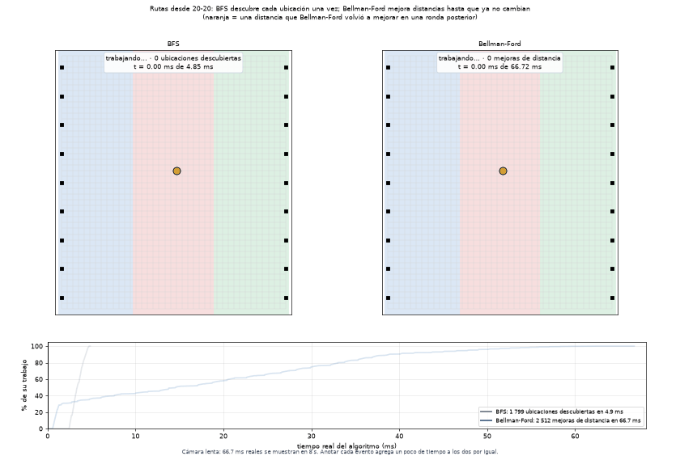

`--duracion 20` la hace más lenta; `--guardar` la guarda como GIF en `resultados/` (tarda unos minutos).

### Análisis de eficiencia (`scripts/analisis.py`)

Corre cada algoritmo en sectores del almacén de 100 a 1800 ubicaciones y ajusta en escala log-log cuánto crece el tiempo. En esta cuadrícula E ≈ 2V:

| Algoritmo | Teórica | Se espera | Se midió | Por qué |
|---|---|---|---|---|
| BFS | O(V + E) | V¹ | V^1,06 | Lineal, como se espera |
| Bellman-Ford | O(V · E) | V² | V^1,26 | Para antes: desde una esquina converge en 2–5 rondas, no en V − 1 |
| Kruskal + UFDS | O(E log E) | ≈ V^1,1 | V^1,09 | El log casi no se nota |
| Prim (heap) | O(E log V) | ≈ V^1,1 | V^1,18 | Ídem; usa más memoria por el heap |
| Edmonds-Karp | O(V · E²) | V³ (peor caso) | V^1,50 | Hace ≈ √V caminos de aumento, cada uno con un BFS de O(V) |
| Floyd-Warshall | O(V³) | V³ | V^2,90 | Coincide; por eso solo se corre hasta 225 ubicaciones |

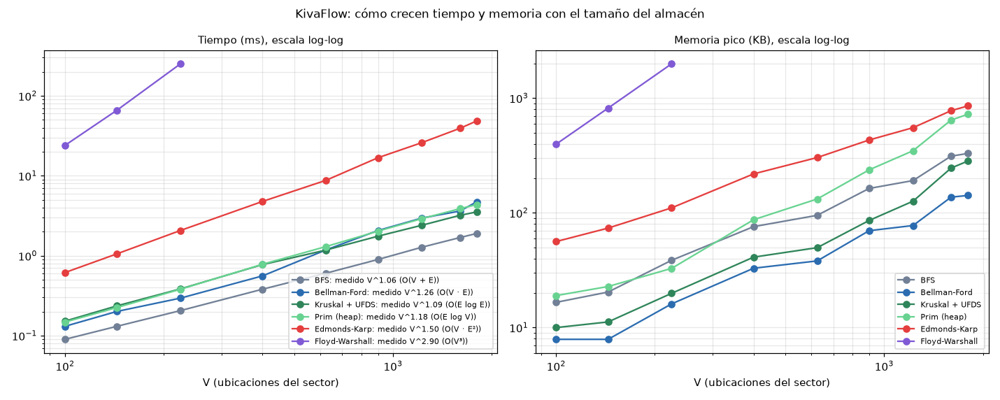

## Demo del MST (red de servicio)

```bash
python scripts/demo_mst.py             # detalle en consola + resultados/mst_etapas.png y mst_red_servicio.png
python scripts/demo_mst.py --ejemplo   # Kruskal paso a paso en 5 nodos, con los grupos del UFDS
python scripts/demo_mst.py --animar    # ventana con Kruskal y Prim creciendo lado a lado
```

El MST usa `Distancia_Ajustada_m` (con `Distancia_m` todos los pasillos miden 1,2 m y cualquier árbol costaría igual). Resultado: 1799 pasillos y 2448,78 m ajustados con los dos algoritmos; solo 174 pasillos de congestión alta, de los 1168 del almacén.

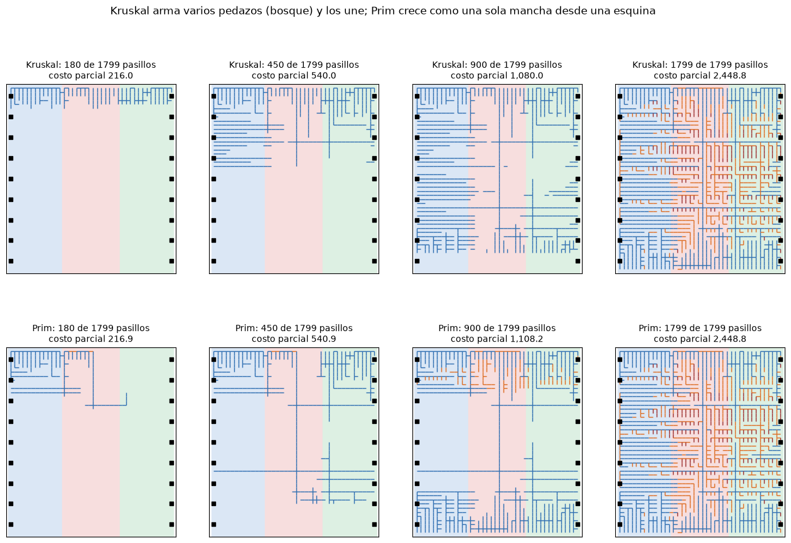

## Demo de los algoritmos de la unidad 2 (hito 2)

La demo sigue las hojas de ejercicios del profe de las semanas 9 a 12 y aplica cada algoritmo al mapa de 3 zonas. Todo está programado a mano con la librería estándar; matplotlib solo dibuja y NetworkX solo se usa en los tests para comparar.

```bash
python scripts/demo.py todo              # todas las demos: detalle en consola + PNG en resultados/
python scripts/demo.py flujo --mostrar   # una sola, y además abre la ventana
```

| Subcomando | Hoja del profe | Algoritmo | Qué responde en el almacén | Resultado |
|---|---|---|---|---|
| `mst` | 10 | Kruskal (UFDS) y Prim (heap) | Red de servicio con la menor distancia ajustada | 1799 pasillos, 2448,78 m |
| `fuerza-bruta` | 10, ej. 1 | MST probando todos los subconjuntos | Valida Kruskal en un sector de 3 × 4 | 12 376 subconjuntos, mismo costo 13,20 |
| `flujo` | 11 | Ford-Fulkerson (DFS) y Edmonds-Karp (BFS), con corte mínimo | Cuántos operarios/min pasan de Recepción a Despacho y qué pasillos lo limitan | 73 operarios/min con los dos (72 caminos con DFS, 53 con BFS); el corte son 45 pasillos dentro de Picking |
| `ruta` | 13 | BFS (línea base) y Bellman-Ford | Ruta que evita la congestión frente a la de menos pasillos | Los mismos 52 pasillos (62,4 m), pero 1 de congestión alta en vez de 48: 65 s frente a 89 s |
| `floyd` | 13 | Floyd-Warshall | Distancias entre todas las ubicaciones de un sector de 10 × 10 de Picking | Matriz 100 × 100; coincide con Bellman-Ford |
| `mochila` | 12 | Mochila 0/1 (DP) | Qué productos lleva un robot de 20 kg en el primer viaje | Urgencia 40 con 6 de 10 productos |

Capacidades del flujo: pasillo de congestión Baja = 3, Media = 2, Alta = 1 operarios/min (`CAPACIDAD_OPERARIOS_MIN` en `config.py`).

Fibonacci, Ackermann y cambio de monedas (hoja 12) son práctica de DP sin uso directo en el almacén. El clustering de la hoja 10 se probó y se descartó: con solo tres pesos posibles en la cuadrícula, cortar las k − 1 aristas más caras del MST deja nodos sueltos en vez de sectores.

| | |
|---|---|
| 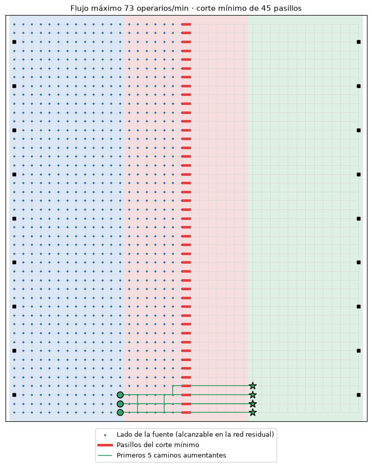 | 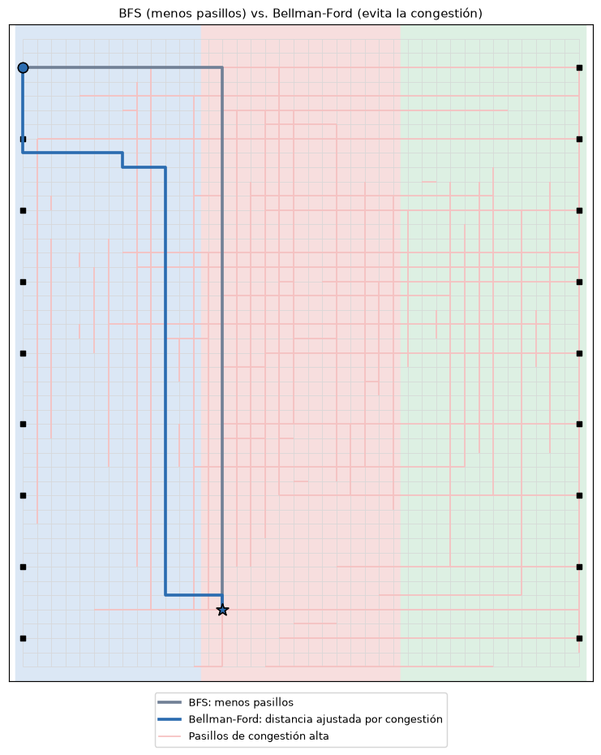 |
| 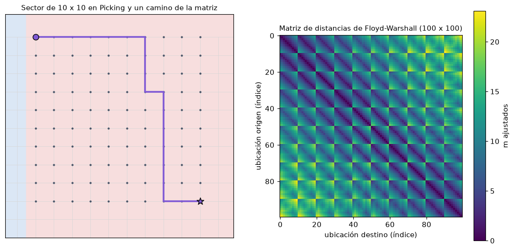 | 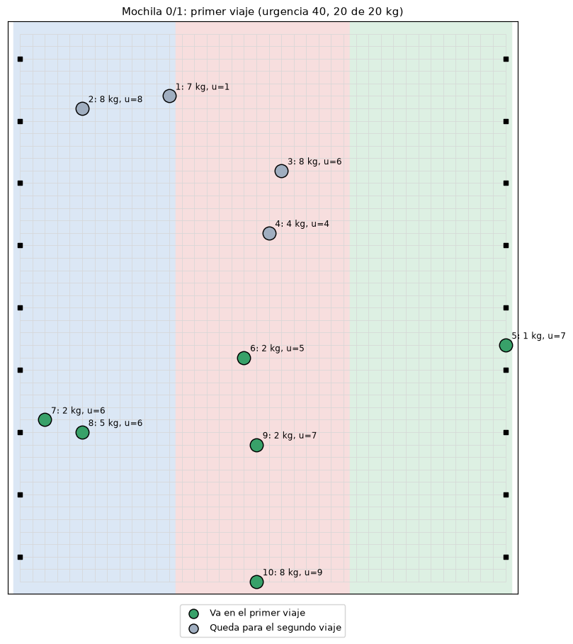 |

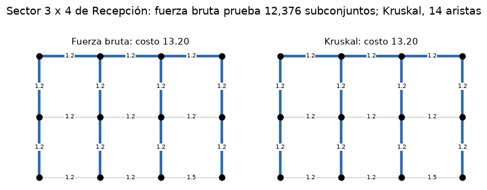

## El dataset

### Por qué es sintético

Amazon no publica la planimetría de sus *fulfillment centers*, y los datasets públicos de *order picking* traen pedidos pero no la **topología** del almacén (qué ubicación está conectada con cuál). Por eso el layout se genera como la cuadrícula de los sistemas robóticos Kiva (Wurman et al., 2008), y lo único que viene de datos reales (opcional) es la **demanda**: qué productos se piden y cuáles van juntos.

### Cómo se construye

1. **Layout** ([`kivaflow/layout.py`](kivaflow/layout.py)): cuadrícula de 45 × 40 ubicaciones con 1,2 m entre vecinas, conectadas con sus 4 vecinas. Son 45·39 + 40·44 = **3515 aristas**. Tres zonas por bandas de columnas: Recepción y Almacenamiento (585 nodos), Picking (630) y Empaque y Despacho (585). Hay 18 estaciones (muelles) en los bordes y el resto son racks.
2. **Demanda** ([`kivaflow/demanda.py`](kivaflow/demanda.py)): 2000 pedidos, que salen de:
   - **sintética** (por defecto): la popularidad de los productos sigue una ley de Zipf (el producto de rango *r* se pide ~1/*r* veces);
   - **Instacart** (opcional): los 1782 productos más pedidos de *Instacart Market Basket Analysis* (uno por rack) y una muestra uniforme de pedidos reales.
3. **Tráfico** ([`kivaflow/trafico.py`](kivaflow/trafico.py)): cada producto va a un rack; cada pedido sale de un muelle de despacho, visita sus racks y vuelve. Se cuenta cuántas veces se cruza cada pasillo y, por terciles, se le da a cada arista una **Frecuencia_Pedidos** Baja, Media o Alta. Así la congestión sale de los pedidos y no se asigna al azar.

Todo es determinista (semilla fija en [`kivaflow/config.py`](kivaflow/config.py)), así que cada vez se generan los mismos archivos.

### Archivos ([`data/`](data/))

**`aristas.csv`**: una fila por pasillo (se recorre en ambos sentidos).

| Columna | Significado |
|---|---|
| `Nodo_Origen`, `Nodo_Destino` | ubicación `fila-columna` |
| `Pasillo` | `Hff` si es horizontal (fila), `Vcc` si es vertical (columna) |
| `Distancia_m` | distancia física (1,2 m) |
| `Cruces_Simulados` | veces que las rutas de los pedidos cruzaron este pasillo |
| `Frecuencia_Pedidos` | Baja / Media / Alta (terciles de `Cruces_Simulados`) |
| `Distancia_Ajustada_m` | `Distancia_m` × 1,0 / 1,25 / 1,6 según la congestión |
| `Tiempo_Estimado_s` | `Distancia_Ajustada_m` / 1,1 m/s |
| `Zona_Origen`, `Zona_Destino` | zona de cada extremo |

**`nodos.csv`**: `Nodo, Fila, Columna, X_m, Y_m, Zona, Tipo (rack | estacion), SKU`.

**`skus.csv`**: `SKU, Veces_Pedido, Fuente`. Son solo conteos agregados.

## Uso

```bash
python -m venv .venv
.venv/Scripts/activate          # Windows; en Linux/Mac: source .venv/bin/activate
pip install -r requirements.txt

python scripts/generar_dataset.py      # data/*.csv con demanda sintética
python scripts/dibujar_grafo.py        # docs/image/grafo.png
python -m pytest                       # comprueba tamaño, conectividad, pesos y reproducibilidad
```

### Con pedidos reales de Instacart

1. Inicia sesión en Kaggle, acepta las reglas de la competencia [Instacart Market Basket Analysis](https://www.kaggle.com/c/instacart-market-basket-analysis/data) y descarga los datos.
2. Descomprime `order_products__prior.csv` en una carpeta `instacart/` dentro del repo. Está en `.gitignore`: **los datos crudos no se suben**, porque las reglas de la competencia no permiten volver a publicarlos.
3. Ejecuta:

```bash
python scripts/generar_dataset.py --instacart instacart
```

El archivo tiene unos 32 millones de filas. Se lee en dos pasadas sin cargarlo entero en memoria y tarda unos minutos.

## Uso de IA

El código y la documentación de este repositorio se escribieron con asistencia de Claude (Anthropic). El grupo lo revisó y lo registró en la bitácora de IA del informe, como pide el curso.

## Referencias

- Held, M., & Karp, R. M. (1962). A dynamic programming approach to sequencing problems. *Journal of the Society for Industrial and Applied Mathematics, 10*(1), 196–210. https://doi.org/10.1137/0110015
- Wurman, P. R., D'Andrea, R., & Mountz, M. (2008). Coordinating hundreds of cooperative, autonomous vehicles in warehouses. *AI Magazine, 29*(1), 9–20. https://doi.org/10.1609/aimag.v29i1.2082
- Instacart. (2017). *Instacart Market Basket Analysis* [Conjunto de datos]. Kaggle. https://www.kaggle.com/c/instacart-market-basket-analysis

## Licencia

[MIT](LICENSE) para el código. Los datos de Instacart tienen sus propias condiciones de uso en Kaggle.
