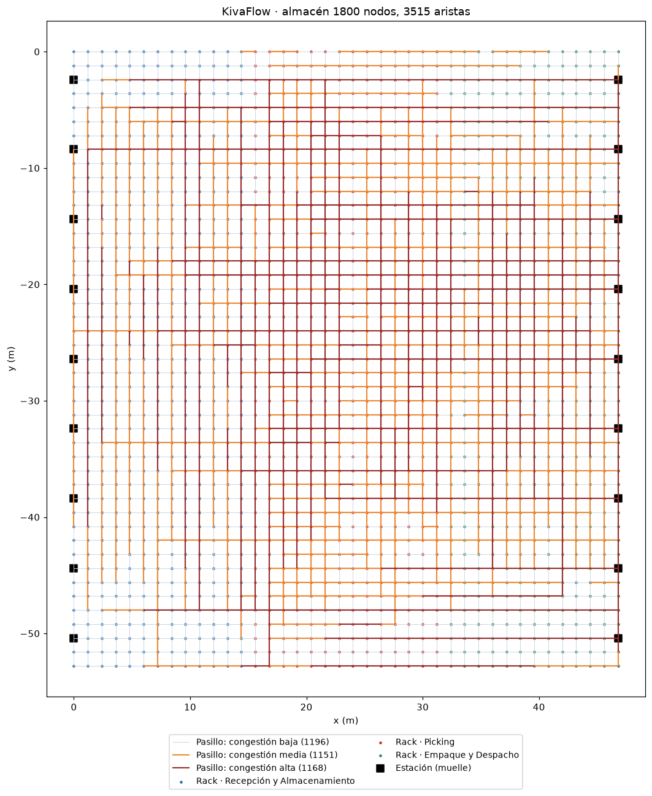

# KivaFlow

Rutas de *picking* y cuellos de botella en un almacén inteligente tipo Amazon, modelado como un grafo de **1800 nodos y 3515 aristas**.

Proyecto del curso **Complejidad Algorítmica (1ACC0184)**, Universidad Peruana de Ciencias Aplicadas, 2026-2.



## Estado

| Parte | Estado |
|---|---|
| Dataset (layout + tráfico simulado) | ✅ reproducible, con tests |
| Pedidos reales de Instacart | 🧪 script listo; falta correrlo con los datos de Kaggle |
| BFS, Bellman-Ford, Edmonds-Karp | 🔜 |
| GUI en Streamlit (con enlace público) | 🔜 |

## El dataset

### Por qué es sintético

Amazon no publica la planimetría de sus *fulfillment centers*, y los datasets públicos de *order picking* traen pedidos pero no la **topología** del almacén (qué ubicación está conectada con cuál). Por eso el layout se genera como la cuadrícula de los sistemas robóticos Kiva (Wurman et al., 2008), y lo único que viene de datos reales (opcional) es la **demanda**: qué productos se piden y cuáles van juntos.

### Cómo se construye

1. **Layout** ([`kivaflow/layout.py`](kivaflow/layout.py)): cuadrícula de 45 × 40 ubicaciones con 1,2 m entre vecinas, conectadas con sus 4 vecinas. Son 45·39 + 40·44 = **3515 aristas**. Tres zonas por bandas de columnas: Recepción y Almacenamiento (585 nodos), Picking (630) y Empaque y Despacho (585). Hay 18 estaciones (muelles) en los bordes y el resto son racks.
2. **Demanda** ([`kivaflow/demanda.py`](kivaflow/demanda.py)): 2000 pedidos, que salen de:
   - **sintética** (por defecto): la popularidad de los productos sigue una ley de Zipf (el producto de rango *r* se pide ~1/*r* veces);
   - **Instacart** (opcional): los 1782 productos más pedidos de *Instacart Market Basket Analysis* (uno por rack) y una muestra uniforme de pedidos reales.
3. **Tráfico** ([`kivaflow/trafico.py`](kivaflow/trafico.py)): cada producto va a un rack; cada pedido sale de un muelle de despacho, visita sus racks y vuelve. Se cuenta cuántas veces se cruza cada pasillo y, por terciles, se le da a cada arista una **Frecuencia_Pedidos** Baja, Media o Alta. Así la congestión sale de los pedidos y no se asigna al azar.

Todo es determinista (semilla fija en [`kivaflow/config.py`](kivaflow/config.py)), así que cada vez se generan los mismos archivos.

### Archivos ([`data/`](data/))

**`aristas.csv`**: una fila por pasillo (se recorre en ambos sentidos).

| Columna | Significado |
|---|---|
| `Nodo_Origen`, `Nodo_Destino` | ubicación `fila-columna` |
| `Pasillo` | `Hff` si es horizontal (fila), `Vcc` si es vertical (columna) |
| `Distancia_m` | distancia física (1,2 m) |
| `Cruces_Simulados` | veces que las rutas de los pedidos cruzaron este pasillo |
| `Frecuencia_Pedidos` | Baja / Media / Alta (terciles de `Cruces_Simulados`) |
| `Distancia_Ajustada_m` | `Distancia_m` × 1,0 / 1,25 / 1,6 según la congestión |
| `Tiempo_Estimado_s` | `Distancia_Ajustada_m` / 1,1 m/s |
| `Zona_Origen`, `Zona_Destino` | zona de cada extremo |

**`nodos.csv`**: `Nodo, Fila, Columna, X_m, Y_m, Zona, Tipo (rack | estacion), SKU`.

**`skus.csv`**: `SKU, Veces_Pedido, Fuente`. Son solo conteos agregados.

## Uso

```bash
python -m venv .venv
.venv/Scripts/activate          # Windows; en Linux/Mac: source .venv/bin/activate
pip install -r requirements.txt

python scripts/generar_dataset.py      # data/*.csv con demanda sintética
python scripts/dibujar_grafo.py        # docs/grafo.png
python -m pytest                       # comprueba tamaño, conectividad, pesos y reproducibilidad
```

### Con pedidos reales de Instacart

1. Inicia sesión en Kaggle, acepta las reglas de la competencia [Instacart Market Basket Analysis](https://www.kaggle.com/c/instacart-market-basket-analysis/data) y descarga los datos.
2. Descomprime `order_products__prior.csv` en una carpeta `instacart/` dentro del repo. Está en `.gitignore`: **los datos crudos no se suben**, porque las reglas de la competencia no permiten volver a publicarlos.
3. Ejecuta:

```bash
python scripts/generar_dataset.py --instacart instacart
```

El archivo tiene unos 32 millones de filas. Se lee en dos pasadas sin cargarlo entero en memoria y tarda unos minutos.

## Uso de IA

El código y la documentación de este repositorio se escribieron con asistencia de Claude (Anthropic). El grupo lo revisó y lo registró en la bitácora de IA del informe, como pide el curso.

## Referencias

- Wurman, P. R., D'Andrea, R., & Mountz, M. (2008). Coordinating hundreds of cooperative, autonomous vehicles in warehouses. *AI Magazine, 29*(1), 9–20. https://doi.org/10.1609/aimag.v29i1.2082
- Instacart. (2017). *Instacart Market Basket Analysis* [Conjunto de datos]. Kaggle. https://www.kaggle.com/c/instacart-market-basket-analysis

## Licencia

[MIT](LICENSE) para el código. Los datos de Instacart tienen sus propias condiciones de uso en Kaggle.
