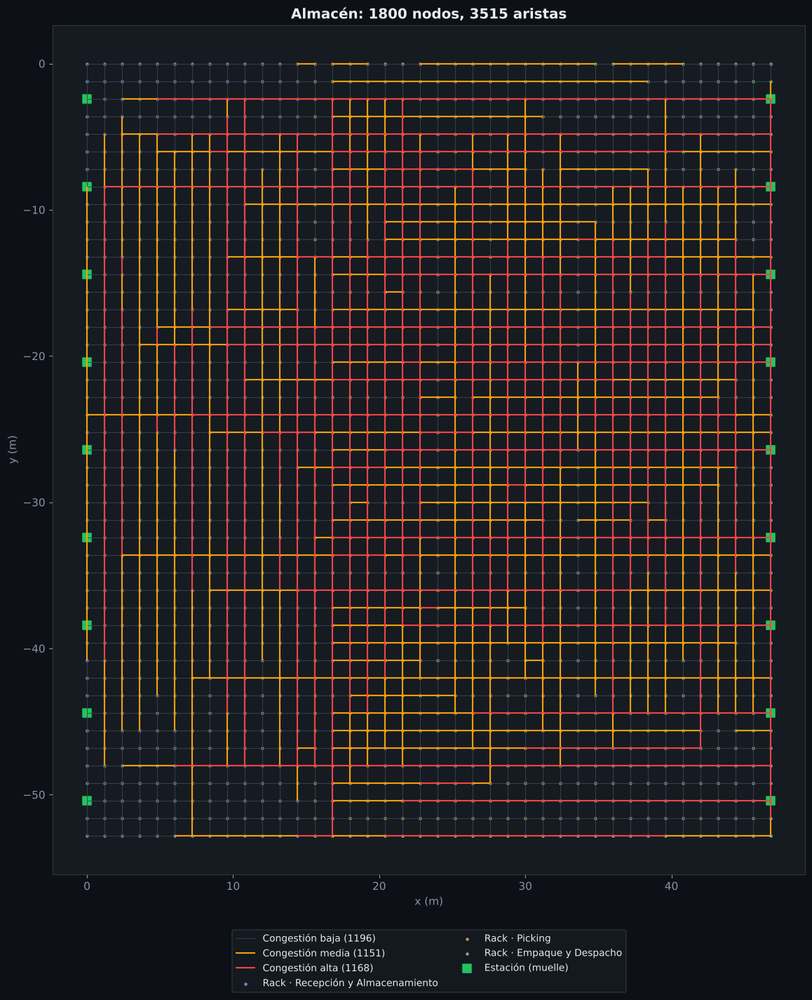

# KivaFlow

Rutas de *picking* y cuellos de botella en un almacén inteligente tipo Amazon, modelado como un grafo de **1800 nodos y 3515 aristas**.

Proyecto del curso **Complejidad Algorítmica (1ACC0184)**, Universidad Peruana de Ciencias Aplicadas, 2026-2.



## Estado

| Parte | Estado |
|---|---|
| Dataset (layout + tráfico simulado) | ✅ reproducible, con tests |
| Pedidos reales de Instacart | 🧪 script listo; falta correrlo con los datos de Kaggle |
| MST: Kruskal (con UFDS) y Prim | ✅ a mano, comparados con NetworkX · demo: `python scripts/demo_mst.py` |
| BFS, Bellman-Ford, Ford-Fulkerson y Edmonds-Karp, Floyd-Warshall, MST por fuerza bruta, mochila 0/1 | ✅ a mano, con tests · demo: `python scripts/demo.py todo` |
| GUI en Streamlit (con enlace público) | 🔜 |

## Ramas

| Rama | Qué tiene |
|---|---|
| `hito2` | Avance paso a paso desde el TB1: dataset, MST (Kruskal y Prim) BFS, Bellman-Ford, Edmonds-Karp y los demás algoritmos de la unidad 2, con demo en matplotlib. Va con el informe del hito 2 |
| `tb2` | Todo lo avanzado para el trabajo final: BFS, Bellman-Ford, Edmonds-Karp, simulación y la app web |
| `main` | Igual que `tb2` por ahora; de aquí sale la app publicada |

## Demo del MST (red de servicio)

```bash
python scripts/demo_mst.py             # detalle en consola + resultados/mst_etapas.png y mst_red_servicio.png
python scripts/demo_mst.py --ejemplo   # Kruskal paso a paso en 5 nodos, con los grupos del UFDS
python scripts/demo_mst.py --animar    # ventana con Kruskal y Prim creciendo lado a lado
```

El MST usa `Distancia_Ajustada_m` (con `Distancia_m` todos los pasillos miden 1,2 m y cualquier árbol costaría igual). Resultado: 1799 pasillos y 2448,78 m ajustados con los dos algoritmos; solo 174 pasillos de congestión alta, de los 1168 del almacén.


## Demo de los algoritmos de la unidad 2 (hito 2)

La demo sigue las hojas de ejercicios del profe de las semanas 9 a 12 y aplica cada algoritmo al mapa de 3 zonas. Todo está programado a mano con la librería estándar; matplotlib solo dibuja y NetworkX solo se usa en los tests para comparar.

```bash
python scripts/demo.py todo              # todas las demos: detalle en consola + PNG en resultados/
python scripts/demo.py flujo --mostrar   # una sola, y además abre la ventana
```

| Subcomando | Hoja del profe | Algoritmo | Qué responde en el almacén | Resultado |
|---|---|---|---|---|
| `mst` | 10 | Kruskal (UFDS) y Prim (heap) | Red de servicio con la menor distancia ajustada | 1799 pasillos, 2448,78 m |
| `fuerza-bruta` | 10, ej. 1 | MST probando todos los subconjuntos | Valida Kruskal en un sector de 3 × 4 | 12 376 subconjuntos, mismo costo 13,20 |
| `flujo` | 11 | Ford-Fulkerson (DFS) y Edmonds-Karp (BFS), con corte mínimo | Cuántos operarios/min pasan de Recepción a Despacho y qué pasillos lo limitan | 73 operarios/min con los dos (72 caminos con DFS, 53 con BFS); el corte son 45 pasillos dentro de Picking |
| `ruta` | 13 | BFS (línea base) y Bellman-Ford | Ruta que evita la congestión frente a la de menos pasillos | Los mismos 52 pasillos (62,4 m), pero 1 de congestión alta en vez de 48: 65 s frente a 89 s |
| `floyd` | 13 | Floyd-Warshall | Distancias entre todas las ubicaciones de un sector de 10 × 10 de Picking | Matriz 100 × 100; coincide con Bellman-Ford |
| `mochila` | 12 | Mochila 0/1 (DP) | Qué productos lleva un robot de 20 kg en el primer viaje | Urgencia 40 con 6 de 10 productos |

Capacidades del flujo: pasillo de congestión Baja = 3, Media = 2, Alta = 1 operarios/min (`CAPACIDAD_OPERARIOS_MIN` en `config.py`).

Fibonacci, Ackermann y cambio de monedas (hoja 12) son práctica de DP sin uso directo en el almacén. El clustering de la hoja 10 se probó y se descartó: con solo tres pesos posibles en la cuadrícula, cortar las k − 1 aristas más caras del MST deja nodos sueltos en vez de sectores.

| | |
|---|---|
|  |  |
|  |  |


## El dataset

### Por qué es sintético

Amazon no publica la planimetría de sus *fulfillment centers*, y los datasets públicos de *order picking* traen pedidos pero no la **topología** del almacén (qué ubicación está conectada con cuál). Por eso el layout se genera como la cuadrícula de los sistemas robóticos Kiva (Wurman et al., 2008), y lo único que viene de datos reales (opcional) es la **demanda**: qué productos se piden y cuáles van juntos.

### Cómo se construye

1. **Layout** ([`kivaflow/layout.py`](kivaflow/layout.py)): cuadrícula de 45 × 40 ubicaciones con 1,2 m entre vecinas, conectadas con sus 4 vecinas. Son 45·39 + 40·44 = **3515 aristas**. Tres zonas por bandas de columnas: Recepción y Almacenamiento (585 nodos), Picking (630) y Empaque y Despacho (585). Hay 18 estaciones (muelles) en los bordes y el resto son racks.
2. **Demanda** ([`kivaflow/demanda.py`](kivaflow/demanda.py)): 2000 pedidos, que salen de:
   - **sintética** (por defecto): la popularidad de los productos sigue una ley de Zipf (el producto de rango *r* se pide ~1/*r* veces);
   - **Instacart** (opcional): los 1782 productos más pedidos de *Instacart Market Basket Analysis* (uno por rack) y una muestra uniforme de pedidos reales.
3. **Tráfico** ([`kivaflow/trafico.py`](kivaflow/trafico.py)): cada producto va a un rack; cada pedido sale de un muelle de despacho, visita sus racks y vuelve. Se cuenta cuántas veces se cruza cada pasillo y, por terciles, se le da a cada arista una **Frecuencia_Pedidos** Baja, Media o Alta. Así la congestión sale de los pedidos y no se asigna al azar.

Todo es determinista (semilla fija en [`kivaflow/config.py`](kivaflow/config.py)), así que cada vez se generan los mismos archivos.

### Archivos ([`data/`](data/))

**`aristas.csv`**: una fila por pasillo (se recorre en ambos sentidos).

| Columna | Significado |
|---|---|
| `Nodo_Origen`, `Nodo_Destino` | ubicación `fila-columna` |
| `Pasillo` | `Hff` si es horizontal (fila), `Vcc` si es vertical (columna) |
| `Distancia_m` | distancia física (1,2 m) |
| `Cruces_Simulados` | veces que las rutas de los pedidos cruzaron este pasillo |
| `Frecuencia_Pedidos` | Baja / Media / Alta (terciles de `Cruces_Simulados`) |
| `Distancia_Ajustada_m` | `Distancia_m` × 1,0 / 1,25 / 1,6 según la congestión |
| `Tiempo_Estimado_s` | `Distancia_Ajustada_m` / 1,1 m/s |
| `Zona_Origen`, `Zona_Destino` | zona de cada extremo |

**`nodos.csv`**: `Nodo, Fila, Columna, X_m, Y_m, Zona, Tipo (rack | estacion), SKU`.

**`skus.csv`**: `SKU, Veces_Pedido, Fuente`. Son solo conteos agregados.

## Uso

```bash
python -m venv .venv
.venv/Scripts/activate          # Windows; en Linux/Mac: source .venv/bin/activate
pip install -r requirements.txt

python scripts/generar_dataset.py      # data/*.csv con demanda sintética
python scripts/dibujar_grafo.py        # docs/grafo.png
python -m pytest                       # comprueba tamaño, conectividad, pesos y reproducibilidad
```

### Con pedidos reales de Instacart

1. Inicia sesión en Kaggle, acepta las reglas de la competencia [Instacart Market Basket Analysis](https://www.kaggle.com/c/instacart-market-basket-analysis/data) y descarga los datos.
2. Descomprime `order_products__prior.csv` en una carpeta `instacart/` dentro del repo. Está en `.gitignore`: **los datos crudos no se suben**, porque las reglas de la competencia no permiten volver a publicarlos.
3. Ejecuta:

```bash
python scripts/generar_dataset.py --instacart instacart
```

El archivo tiene unos 32 millones de filas. Se lee en dos pasadas sin cargarlo entero en memoria y tarda unos minutos.

## Uso de IA

El código y la documentación de este repositorio se escribieron con asistencia de Claude (Anthropic). El grupo lo revisó y lo registró en la bitácora de IA del informe, como pide el curso.

## Referencias

- Wurman, P. R., D'Andrea, R., & Mountz, M. (2008). Coordinating hundreds of cooperative, autonomous vehicles in warehouses. *AI Magazine, 29*(1), 9–20. https://doi.org/10.1609/aimag.v29i1.2082
- Instacart. (2017). *Instacart Market Basket Analysis* [Conjunto de datos]. Kaggle. https://www.kaggle.com/c/instacart-market-basket-analysis

## Licencia

[MIT](LICENSE) para el código. Los datos de Instacart tienen sus propias condiciones de uso en Kaggle.
