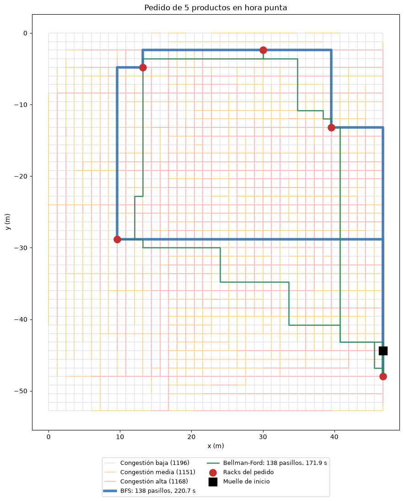
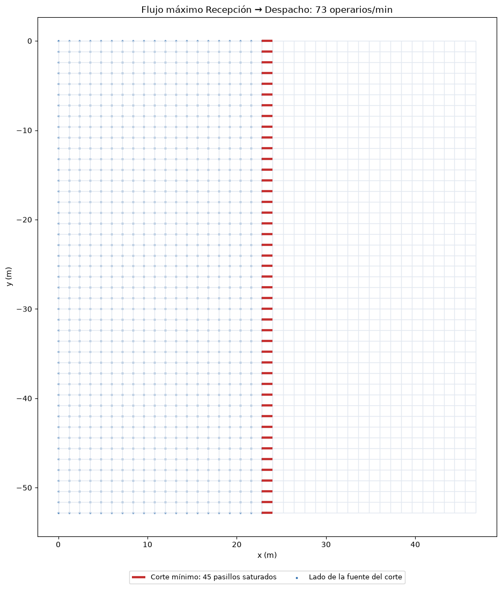

# Resultados de los experimentos

> Generado por `scripts/experimentos.py`. Demanda: **sintetica**. 30 pedidos por escenario; cada uno sale de un muelle de despacho, visita sus racks en orden de vecino más cercano y vuelve. Los tiempos en ms dependen de la PC. *Nodos visitados* y *relajaciones* suman todas las búsquedas del pedido (k productos = k + 1 búsquedas). *Tiempo* es el tiempo estimado de caminata del operario (distancia ajustada / 1,1 m/s).

## Rutas de picking: BFS vs. Bellman-Ford (promedios por pedido)

| Hora | Productos | Pasillos BFS | Pasillos B-F | Tiempo BFS (s) | Tiempo B-F (s) | Ahorro B-F | Nodos visitados BFS | Relajaciones B-F | ms BFS | ms B-F |
|---|---|---|---|---|---|---|---|---|---|---|
| valle | 1 | 75.5 | 75.5 | 99.4 | 84.5 | 14.9 % | 2278 | 5126 | 0.8 | 44.2 |
| valle | 5 | 144.1 | 144.8 | 187.3 | 165.9 | 11.4 % | 4163 | 15336 | 1.5 | 142.7 |
| valle | 10 | 188.0 | 188.1 | 241.3 | 217.4 | 9.9 % | 4776 | 28174 | 2.2 | 261.6 |
| punta | 1 | 75.5 | 75.8 | 123.3 | 87.5 | 29.1 % | 2278 | 5594 | 1.2 | 62.9 |
| punta | 5 | 144.1 | 145.9 | 229.7 | 175.6 | 23.6 % | 4163 | 16735 | 1.7 | 157.4 |
| punta | 10 | 188.0 | 189.4 | 292.7 | 231.7 | 20.8 % | 4776 | 30911 | 2.3 | 263.6 |

## Cuellos de botella: Edmonds-Karp (Recepción → Despacho)

| Flujo máximo | Pasillos en el corte mínimo | Caminos de aumento | ms |
|---|---|---|---|
| 73 operarios/min | 45 | 53 | 37.3 |

Congestión de los pasillos del corte: {'Media': 20, 'Alta': 21, 'Baja': 4}. Columnas donde está el corte: {19: 45}.

